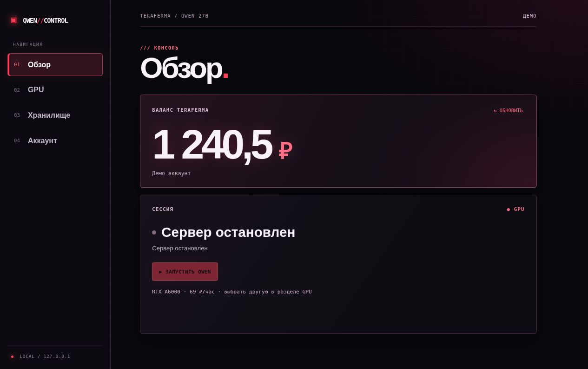
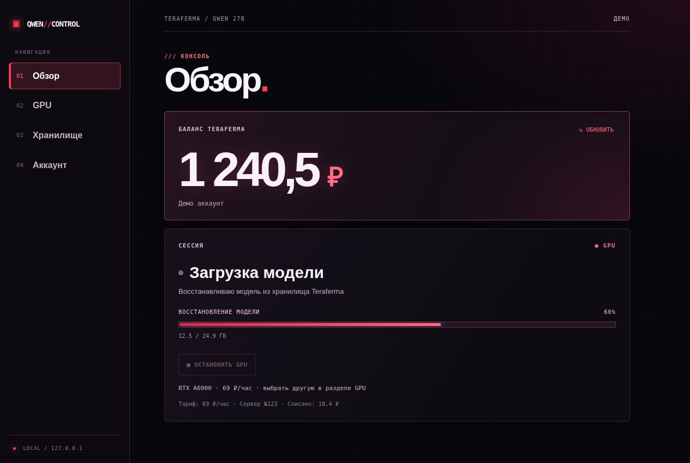
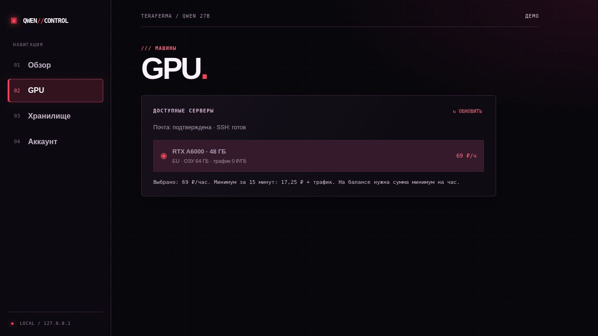

# Teraferma Qwen Panel

Локальная панель для запуска Huihui Qwen3.8 27B Abliterated в сборке Q6_K_L на GPU Teraferma. После готовности модели панель открывает OpenCode с настроенным подключением.

Приложение работает на вашем компьютере по адресу `http://127.0.0.1:8787`. Модель и ее сохраненная копия находятся на стороне Teraferma.

## Как выглядит панель

Снимки сделаны в демонстрационном режиме. Баланс и номер сервера на них вымышленные.

## Быстрый запуск

1. Установите Python 3.11 или новее, OpenSSH, curl и OpenCode. Исполняемый файл OpenCode должен находиться по адресу `~/.local/bin/opencode`.
2. Откройте папку проекта на компьютере.
3. Запустите `./start.sh`.
4. В разделе «Аккаунт» добавьте токен Teraferma. Панель покажет публичный SSH ключ, который нужно добавить в [кабинете Teraferma](https://teraferma.io/kabinet/).
5. На главном экране проверьте баланс и нажмите «Запустить Qwen». Если нужен другой сервер, откройте раздел «GPU».

Для установки на другом компьютере достаточно скопировать проект и повторить настройку аккаунта. Локальные секреты в GitHub не отправляются.

## Что происходит при запуске

Панель подбирает RTX A6000 в пределах лимита профиля, создает сервер с шаблоном PyTorch, подключается по SSH и запускает модель. При готовности модели открывается OpenCode.

Индикатор показывает этап запуска. Во время восстановления или первой загрузки он показывает фактический объем данных. Во время первой сборки движка отображается процент сборки.

Если на аккаунте есть сохраненная папка, панель ждет окончания ее восстановления. Она не начинает еще одну загрузку модели, пока Teraferma переносит сохраненные файлы. Краткий обрыв SSH вызывает автоматическое переподключение.

## Сохранение и расходы

Кнопка сохранения находится в разделе «Хранилище». Модель и собранный движок лежат в `/workspace` на стороне Teraferma. Сохраненная папка привязана к конкретному аккаунту. Для другого аккаунта ее нужно подготовить отдельно.

По [тарифу Teraferma](https://teraferma.io/faq/) хранение стоит 3 ₽ за ГБ в месяц. Папка размером около 25 ГБ обходится примерно в 75 ₽ в месяц. Аренда GPU и трафик оплачиваются отдельно. Восстановление сохраненной папки тоже занимает время и может учитываться как трафик.

По умолчанию профиль ограничивает цену значением 80 ₽ в час, время работы значением 60 минут и расходы значением 3000 ₽ в месяц. Эти значения можно изменить при добавлении аккаунта. Кнопка «Без автостопа» оставляет аренду до ручной остановки.

## Где лежат секреты

Для постоянного хранения API токенов и закрытых SSH ключей используется локальный файл `.env`. Для каждого профиля используются отдельные переменные `TERAFERMA_TOKEN_ID` и `TERAFERMA_SSH_KEY_B64_ID`, где `ID` обозначает идентификатор профиля. Закрытый ключ записан в Base64 для хранения в одной строке. Base64 является кодированием и не шифрует ключ.

Файл `.env` создается автоматически, доступен только владельцу и исключен из Git. Публичные ключи, состояние аренды и локальные журналы находятся в `.local`, которая тоже исключена из Git. Для работы OpenSSH приложение временно помещает закрытый ключ в системную папку `/run/user` с доступом только владельцу.

Если профиль был создан старой версией панели, при следующем запуске токен и закрытый ключ переносятся в `.env`. В OpenCode передается только локальный адрес модели, без токена Teraferma.

## Проверка

Выполните `PYTHONPATH=. python3 tests/test_safety.py` для локальных проверок. Полный запуск модели требует аккаунта Teraferma и оплачиваемого сервера.

Если панель не открылась, проверьте состояние локальной службы через systemctl. Если OpenCode не подключается, сначала проверьте этап запуска на главном экране и состояние сервера в кабинете Teraferma.
